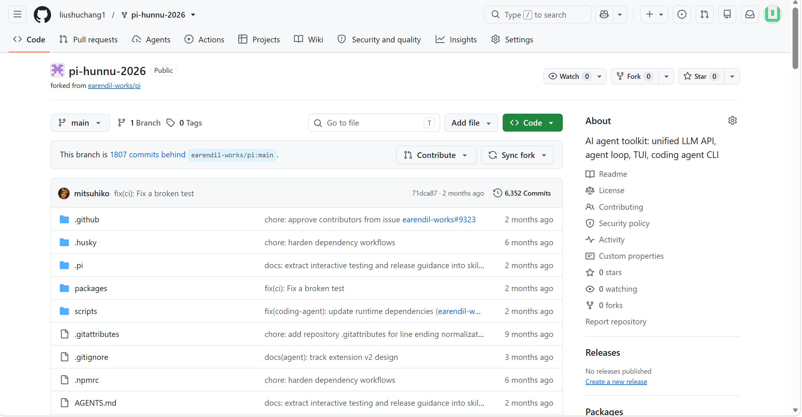
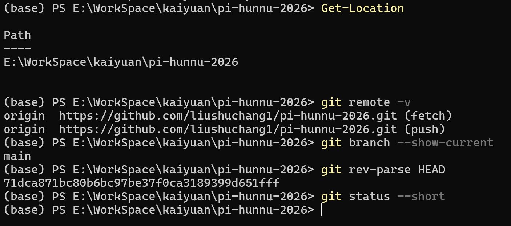
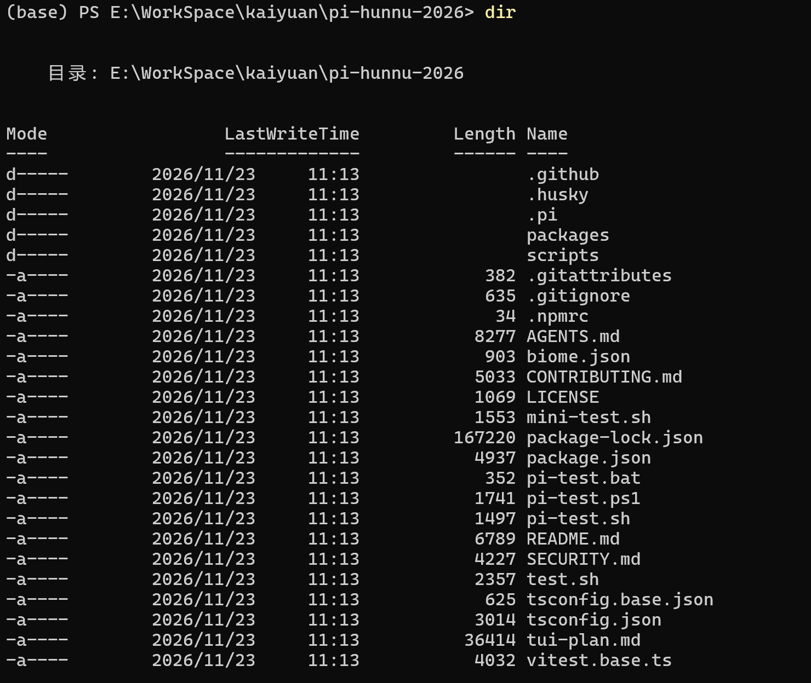
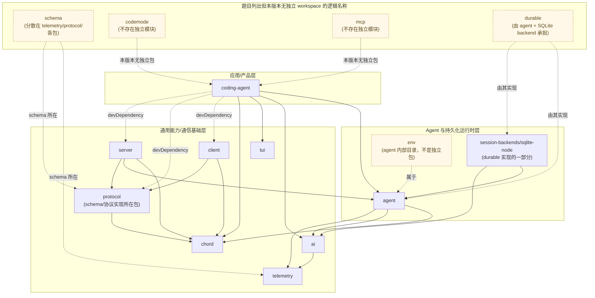

# 实践课2：组织建仓与 Pi‑Agent 源码分析
## 1. 基本信息
- GitHub 登录名：Aglioble
- 小组组织仓库地址：https://github.com/liushuchang1/pi-hunnu-2026
- 本地 clone 完整 commit 哈希：`71dca871bc80b6bc97be37f0ca3189399d651fff`
- 个人报告地址：https://github.com/Aglioble/pi-practice2/blob/main/README.md

## 2. 源码获取
操作：克隆小组组织仓库到本地，执行校验命令，检查仓库远端地址、当前分支、提交哈希，确认源码完整下载至本地。

说明：本地工作目录为 `E:\WorkSpace\kaiyuan\pi-hunnu-2026`；origin 远端指向小组组织仓库；本地分支为 `main`；git 工作区干净无未提交修改。

## 3 任务三：子模块功能与依赖关系分析
> 分析对象：`pi-hunnu-2026`，commit：`71dca871bc80b6bc97be37f0ca3189399d651fff`。本项目为 npm workspaces monorepo，部分题目列出名称在本版本并非独立 workspace 子包，表格内如实标注。

| 子文件夹 | 代码主要实现什么功能 | 本模块 build 执行什么、生成什么 | 直接依赖哪些内部模块 | 依据文件或代码位置 |
|---|---|---|---|---|
| `telemetry` | 提供厂商无关遥测契约，实现 TelemetryContext、TelemetrySpan，提供序列化类型，不绑定具体遥测上报后端。 | `npm run build` 执行 `tsgo -p tsconfig.build.json`，编译 TypeScript 源码输出至 `dist`，生成 JS、`.d.ts` 类型声明、sourceMap。 | 无内部运行依赖 | `packages/telemetry/package.json`、`packages/telemetry/README.md`、`packages/telemetry/tsconfig.build.json` |
| `schema` | 本版本无独立 schema 子文件夹；schema 职责分散：telemetry 提供遥测序列化 schema，protocol 定义消息信封与校验类型，各业务包定义自身业务类型。 | 无独立 build 命令、无独立 dist；相关源码跟随所属模块一同编译。 | 非独立模块，无独立依赖边；protocol 依赖 chord，telemetry 无内部依赖 | `packages/protocol/package.json`、`packages/telemetry/README.md` |
| `chord` | 通用应用运行时，实现插件 Facet、服务生命周期、服务绑定、远程服务边界、复制状态、Delta 跟踪，属于底层基础库。 | `npm run build` 执行 `tsgo -p tsconfig.build.json`，编译输出至 `dist`，生成 JS、类型声明及映射文件。 | 无内部 workspace 依赖 | `packages/chord/README.md`、`packages/chord/package.json` |
| `tui` | 终端UI框架，提供组件、焦点、布局、差异渲染、滚动输出等终端交互能力。 | `npm run build` 执行 `tsgo -p tsconfig.build.json` 编译输出 `dist`；另有平台原生组件构建脚本，不属于默认 build。 | 无内部 workspace 依赖 | `packages/tui/package.json`、`packages/tui/README.md` |
| `codemode` | 本版本不存在 codemode 独立子文件夹与源码目录。 | 无独立 build，无独立 dist 产物。 | 无独立依赖边 | 根目录 `package.json` workspaces，packages 目录清单 |
| `mcp` | 本版本不存在 mcp 独立子模块，文档出现相关字样不代表存在独立模块。 | 无独立 build，相关代码随所属包构建。 | 无独立依赖边 | 根目录 `package.json`，packages 目录清单 |
| `ai` | LLM统一调用层，完成模型提供者适配、鉴权、流式请求、工具调用、消息结构、token统计校验。 | build 先执行 `generate‑models`，再运行 `build:offline`；完成TS编译、模型数据校验，复制provider数据文件到dist。 | `@earendil‑works/pi‑telemetry` | `packages/ai/package.json`、`packages/ai/README.md` |
| `durable` | 无独立 durable 文件夹；持久化能力由 agent 会话抽象 + session‑backends/sqlite‑node 共同实现，sqlite‑node完成会话数据落盘。 | 无durable独立build；agent自行编译；sqlite‑node编译后复制数据库迁移脚本到dist。 | sqlite‑node内部依赖：`pi‑agent-core`、`pi‑ai` | `packages/agent/README.md`、`packages/session‑backends/sqlite‑node/package.json` |
| `env` | 无独立 env 文件夹；是 agent 内部环境适配实现，路径 `packages/agent/src/harness/env/nodejs.ts`。 | 无独立 build，跟随 agent 的 build 编译输出到 agent/dist。 | 属于agent内部；agent依赖 `chord`、`pi‑ai`、`pi‑telemetry` | `packages/agent/src/harness/env/nodejs.ts`、`packages/agent/package.json` |
| `agent` | Agent核心运行时，维护对话状态、消息转换、模型调用、工具执行、会话生命周期、遥测集成。 | `npm run build`执行`tsgo -p tsconfig.build.json`，编译TS源码输出dist目录。 | `@earendil‑works/chord`、`@earendil‑works/pi‑ai`、`@earendil‑works/pi‑telemetry` | `packages/agent/package.json`、`packages/agent/README.md` |
| `coding‑agent` | 用户终端入口，实现CLI交互、RPC、SDK、扩展机制，组合下层能力完成编码智能体。 | build分为两步：先unbundled编译TS、复制静态资源；再运行bundle脚本生成打包产物。 | 运行内部依赖：`chord`、`pi‑agent‑core`、`pi‑ai`、`pi‑tui`；开发依赖 client、protocol、server(devDependencies) | `packages/coding‑agent/package.json`、`scripts/build‑coding‑agent‑bundle.mjs` |

### 模块层级与依赖关系图

\\### 结合分析回答
\\#### 1. 根目录与子模块中的 `npm run build` 分别读取什么配置、执行什么工作？
本项目为 npm workspaces monorepo。
根目录下 `npm run build` 是一组 shell 脚本，不会直接调用 TypeScript 编译器，按照预设顺序依次进入各个子包，调用每个子包自身的 `npm run build`。根脚本只负责流程编排，读取根目录 `package.json`，实际编译交由各个子包完成。
子模块的 `npm run build` 读取本子包 `package.json` 的 build 脚本，再读取本子包的 `tsconfig.build.json`，控制编译输入输出。
\\- `chord`、`tui`、`telemetry`、`agent`：调用 tsgo 编译 TypeScript 输出 dist；
\\- `ai`：额外做模型数据生成、校验，复制 provider 资源；
\\- `session‑backends/sqlite‑node`：编译后复制数据库迁移脚本；
\\- `coding‑agent`：编译源码、复制静态资源，再执行 bundle 打包脚本。
各子包继承根目录 `tsconfig.base.json` 的公共编译配置，每个包使用自身的 `tsconfig.build.json` 限定编译范围。

\\#### 2. 构建顺序和模块依赖有什么关系？相邻构建的模块是否一定互相依赖？
构建需要遵循拓扑顺序：被依赖模块要优先完成构建。如果 A 依赖 B，B 必须先 build，否则 A 编译找不到 B 的类型与产物。
例如 `telemetry` 在 `ai` 之前构建；`ai`、`chord`、`telemetry` 在 `agent` 之前构建；`agent` 在 `coding‑agent` 之前构建。
相邻构建的模块\\\*\\\*不一定互相依赖\\\*\\\*。根目录的构建顺序为人为编排，两个模块先后执行，不代表存在 `package.json` 的依赖声明。
例如脚本中 `chord` 之后紧接着 `tui`，但 tui 不依赖 chord。判断直接依赖的依据是查看 `package.json` 的 dependencies，不能依靠构建先后顺序。

\\#### 3. 选择一条涉及至少三个模块的依赖路径，说明这些模块如何分工
选取依赖路径：`coding‑agent → agent → ai → telemetry`，箭头代表左侧模块使用右侧模块。
1\\. `coding‑agent`：上层用户入口，处理 CLI 命令、终端交互，接收用户输入，调用 agent 执行任务。
2\\. `agent`：智能体核心运行时，维护会话上下文，流转消息，调度工具，调用 ai 模块请求大模型。
3\\. `ai`：模型访问抽象层，屏蔽不同 LLM 服务商差异，处理鉴权、流式响应、工具调用数据封装。
4\\. `telemetry`：底层遥测库，提供统一 Span、上下文观测接口，为 agent、ai 提供运行埋点能力。
`agent`同时直接依赖`ai`与`telemetry`，`ai`依赖`telemetry`，依赖关系均可在对应 package.json 找到声明。

\\### 本人重点分析的模块
本次重点分析模块：`telemetry`、`agent`、`coding‑agent`，查阅对应 package.json、README 及入口源码，梳理模块功能、build 脚本与内部依赖。

